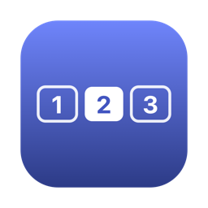

<p align="center">
  
</p>

<h1 align="center">DeskJump</h1>

<p align="center">
  Your macOS desktops as numbers in the menu bar. Click one to jump straight to it.
</p>

<p align="center">
  
</p>

---

macOS lets you create several desktops (Spaces), but there's no built-in way to see how many you have, which one you're on, or to jump to one with a click. DeskJump adds a small strip to the menu bar:

```
 [1] [■2] [3]
```

- **One box per desktop** on the display under your mouse. The filled box is the desktop you're on.
- **Click a number** to jump straight to that desktop.
- **Full-screen apps** show up as `F`.
- **Multiple displays** with *Displays have separate Spaces* turned on: DeskJump shows the desktops of the display your mouse is on.
- **Right-click** for settings: check for updates, launch at login, instant switching, open Mission Control, quit.

## Install

### Homebrew

```bash
brew install --cask kaifacun/tap/deskjump
open -a DeskJump
```


### Manual

1. Download `DeskJump-x.y.z.zip` from the [latest release](https://github.com/kaifacun/deskjump/releases/latest).
2. Unzip it and move `DeskJump.app` to `/Applications`.
3. Open it.

DeskJump needs macOS 13 Ventura or later and runs on Apple silicon and Intel Macs.

## Update

DeskJump checks GitHub for a new version once a day. When there is one, a small dot appears next to the numbers. Right-click › **Update to DeskJump x.y.z…** downloads it, checks that it's signed by the DeskJump developer and notarized by Apple, replaces the app and restarts it. You can also check any time with right-click › **Check for Updates…**.

In-app updates start with version 1.0.3. If you have 1.0.2 or earlier, update once with Homebrew or manually as below.

With Homebrew:

```bash
brew update
brew upgrade --cask deskjump
```

Run `brew update` first. Homebrew refreshes taps only once in a while on its own, so without it `brew upgrade` may report that the latest version is already installed.

If you installed manually, download the new zip and replace `/Applications/DeskJump.app`.

Updates are signed with the same Developer ID, so you don't need to grant Accessibility access again.

> **Upgrading from 1.0.0:** version 1.0.0 assigned the desktop shortcuts to `⌃1` … `⌃0`. These often clash with other apps' shortcuts (for example, a screenshot tool on `⌃1` would fire together with the desktop switch). Newer versions use `⌃⌥⇧1` … `⌃⌥⇧0` instead, but they don't change shortcuts that are already set. To switch over:
>
> 1. Open *System Settings › Keyboard › Keyboard Shortcuts › Mission Control*.
> 2. Change each "Switch to Desktop N" shortcut to `⌃⌥⇧N`, or to anything else you don't use.
>
> DeskJump uses whatever combination you set.

## First launch

On first launch DeskJump:

1. **Asks for Accessibility access.** Turn on **DeskJump** in *System Settings › Privacy & Security › Accessibility*. DeskJump needs this to send the keyboard shortcut that switches desktops. It works as soon as you flip the switch, with no relaunch.
2. **Registers itself to launch at login.** You can turn this off from the right-click menu or in *System Settings › General › Login Items*.
3. **Turns on macOS's "Switch to Desktop 1–10" shortcuts** if none are set up yet, so clicks jump directly instead of stepping one desktop at a time. DeskJump assigns them to `⌃⌥⇧1` … `⌃⌥⇧0`, a combination apps rarely use, so it doesn't collide with common `⌃1`-style shortcuts (e.g. screenshot tools). You never press these yourself. They are standard shortcuts in *System Settings › Keyboard › Keyboard Shortcuts › Mission Control*, and you can change or turn them off there. DeskJump uses whatever combination is set.

## How it works

- **Reading desktops:** DeskJump reads the list of desktops and the current one from the WindowServer, using the same private SkyLight call (`CGSCopyManagedDisplaySpaces`) that the Dock uses. Nothing is modified.
- **Switching:** macOS has no public API for switching desktops. DeskJump posts the same keyboard shortcut you would press:
  - `⌃N` ("Switch to Desktop N") when it's enabled.
  - Otherwise `⌃←` / `⌃→` repeatedly.
  - After a direct jump it checks that it landed on the right desktop and corrects with arrow steps if not.
- **Clicks on the strip:** recent macOS versions deliver every status-item click at the item's center. DeskJump therefore uses the real mouse position to work out which number you clicked.

The only network request DeskJump makes is the update check against the GitHub Releases API (once a day, or when you choose *Check for Updates…*). It collects no data.

## Troubleshooting

| Problem | Fix |
|---|---|
| Clicking does nothing | Check that DeskJump is on in *Privacy & Security › Accessibility*. If it is, remove it with **−** and add it again. |
| Jumps step through each desktop | Right-click › **Enable Instant Switching**, or turn on "Switch to Desktop N" in Keyboard Shortcuts. |
| Want logs | `defaults write com.kaifacun.deskjump DebugLogging -bool true`, then see `~/Library/Logs/DeskJump.log`. |

## Uninstall

```bash
brew uninstall --zap --cask deskjump
```

Or quit DeskJump from the right-click menu and delete `/Applications/DeskJump.app`.

## Build from source

You need Xcode or the Command Line Tools (Swift 5.9+).

```bash
git clone https://github.com/kaifacun/deskjump.git
cd deskjump
./build.sh --install    # build a Universal app, copy to /Applications and launch
```

`build.sh` signs with the first *Developer ID Application* or *Apple Development* identity it finds, or ad-hoc otherwise. With ad-hoc signing macOS treats every rebuild as a new app, so you'll need to re-grant Accessibility after each build.

### Releasing (maintainers)

See [docs/RELEASING.md](docs/RELEASING.md). In short: `./release.sh 1.0.1` on a Mac with the signing certificate, or `git tag v1.0.1 && git push origin v1.0.1` from anywhere (GitHub Actions signs, notarizes and publishes).

## License

[MIT](LICENSE)
